  

  

  
  
  

 

  
  
  
  

---

### 👋 About Me

I build mobile and AI products end to end, from the first brief to the store release, and I own features rather than tickets. Sole mobile engineer on **Corteksa**, a multi-tenant B2B CRM used by Saudi businesses, and builder of my own AI apps on Google Play.

- 🤖 **AI in production:** the app side of a multi-agent AI assistant (streamed agent and tool-call events, human approval before any data changes), on-device **Whisper** speech-to-text, **Gemini** structured extraction, and **Claude** / Gemini in my own tools
- 📱 **Mobile, native when it matters:** Flutter for the product, native Kotlin and Swift where Flutter can't reach, like replying from a notification with the app fully closed
- 🔌 **Real-time and integrations:** WebSocket messaging across WhatsApp, Instagram, Messenger and TikTok, plus Gmail, Outlook and IMAP email
- 📴 **Offline-first:** a durable outbox with ordering, backoff, crash recovery and idempotency keys, so nothing is lost or sent twice
- 🔐 **Security:** encrypted token storage (Keychain, Android Keystore), single-flight token refresh, role-based permissions
- 🧪 **Quality:** 4,000+ unit, widget and BLoC tests, and one CI/CD pipeline that ships both platforms
- 🌍 **Built for the region:** Arabic (full RTL), English and Turkish as a first-class concern, not a retrofit

---

### 🚀 Shipped to Production

| Product | What it is | Stack | Links |
| :-- | :-- | :-- | :-- |
| **Corteksa** | Multi-tenant B2B CRM: no-code business objects (33 field types), omnichannel inbox, email client and an AI agent assistant | Flutter · Kotlin · Swift · WebSockets | [Google Play](https://play.google.com/store/apps/details?id=com.moontij.corteksa) · [App Store](https://apps.apple.com/us/app/corteksa/id6772713745) |
| **Recallly** | Voice-to-CRM: talk through a client visit and get structured CRM data. Whisper runs on the device for offline transcription, Gemini extracts the fields | Kotlin · Jetpack Compose · whisper.cpp · Gemini | [Google Play](https://play.google.com/store/apps/details?id=com.at.recallly) · [Code](https://github.com/7pak/Recallly) |
| **AutoInvo** | AI receipt scanner: camera OCR reads merchant, amount and date, AI categorizes each expense, offline-first sync and PDF reports | Flutter · OCR · AI | [Google Play](https://play.google.com/store/apps/details?id=com.at.autoinvo.auto_invo) · [Code](https://github.com/7pak/Autoinvo) |
| **Mwaqi3** | Arabic-first business directory for a Kuwait client: stories, offers, Google Maps and a custom design system | Flutter · Firebase | [Google Play](https://play.google.com/store/apps/details?id=com.at.mwaqi3) |
| **job-alert-bot** | Self-hosted Telegram alerts for matching jobs minutes after they are posted, with an optional Gemini check of each post and Claude CV tailoring | Python · SQLite · Docker · GitHub Actions | [Code](https://github.com/7pak/job-alert-bot) |

---

### 🛠️ Tech Stack

  

 

| | |
| :-- | :-- |
| **Mobile** | Flutter · Dart · Kotlin · Jetpack Compose · Swift · Platform Channels · Hilt · Room · Coroutines |
| **AI** | LLM APIs (Gemini, Claude, OpenAI) · AI agents and tool calling · RAG · LangChain · LangGraph · Vector databases · Whisper (on-device) · Prompt engineering · Human-in-the-loop |
| **Architecture** | Clean Architecture · BLoC/Cubit · MVVM · SOLID · Offline-first · Multi-tenant |
| **Backend & data** | Python · FastAPI · REST · WebSockets (Socket.IO) · OAuth 2.0 · Firebase · Supabase · PostgreSQL · SQLite · Docker |
| **Delivery** | Unit, widget and BLoC tests · Codemagic and GitHub Actions CI/CD · Crashlytics · Claude Code · Cursor |

---

### 📦 Open Source

  
  
  
  

---

### 📊 GitHub Stats

  
  

  

  

  <picture>
    <source media="(prefers-color-scheme: dark)" srcset="https://raw.githubusercontent.com/7pak/7pak/output/snake-dark.svg" />
    <source media="(prefers-color-scheme: light)" srcset="https://raw.githubusercontent.com/7pak/7pak/output/snake.svg" />
    
  </picture>

---

  <b>Open to Mobile, AI and Solutions roles in the UAE and the GCC.</b> 
  Based in the UAE · Arabic and English · <a href="https://abdalla-tawfig.vercel.app">abdalla-tawfig.vercel.app</a>

  

<!--
  The stats, language and project cards in assets/ are generated by
  scripts/generate-cards.mjs and refreshed every 12h by .github/workflows/cards.yml.
  They are rendered in this repo on purpose, so no third-party card service can go down.
-->
